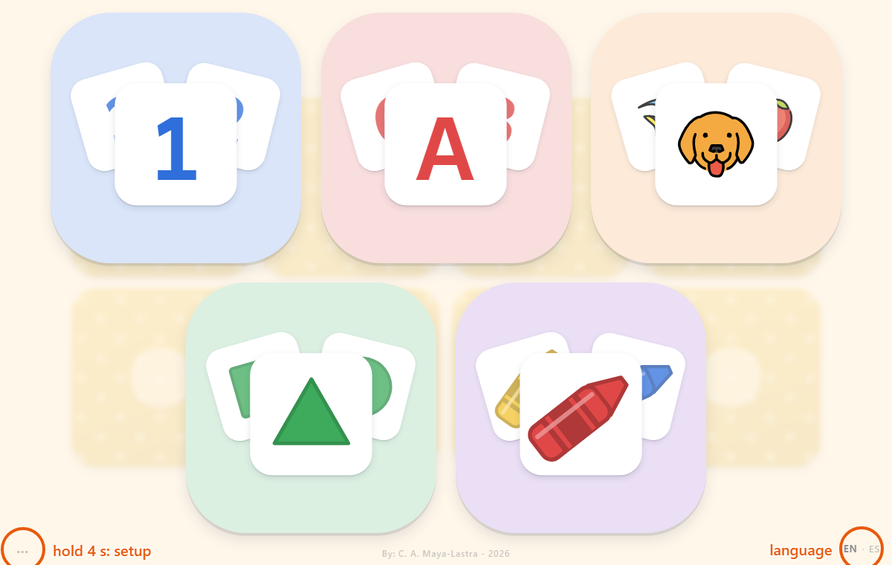
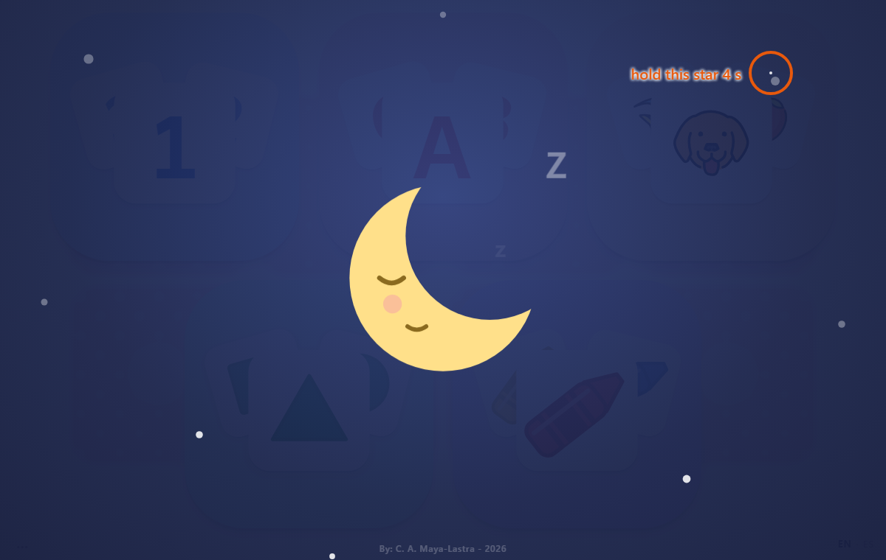

# Memoriter

A gentle memory game for toddlers, in English and Spanish.

**Play it:** https://camayal.info/wa/pairs

The child flips two cards to find a pair. Each card says its word out loud when it turns over (a number, a letter, an animal, a shape or a color). This way the child learns new words while practising memory.

It is also made to be calm. There is no score and no timer, and the colors are soft. Nothing moves until the child touches it. After a few games, a sleepy moon says it is time for a break.

## For parents

- **Language:** tap **EN · ES** in the bottom-right corner.
- **Settings:** hold the faint **…** in the bottom-left corner for 4 seconds.
- **Break time:** the break screen has nothing for the child to tap. To end the break, hold the small star near the top-right corner for 4 seconds.

---

Pictures by [OpenMoji](https://openmoji.org) (CC BY-SA 4.0). Code under CC0 (see `LICENSE`). AI supported development.
